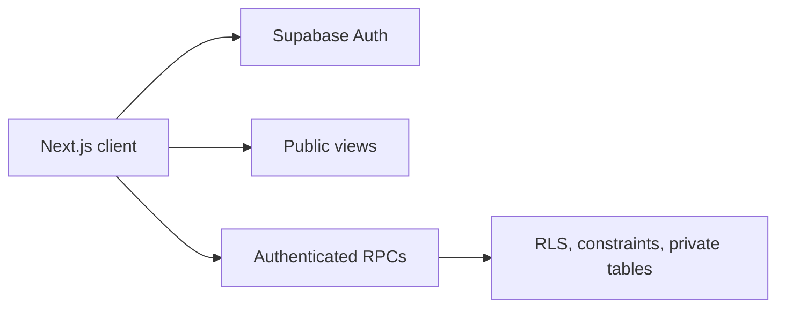

# Thesis Connect

Thesis Connect is a BRAC University student platform for finding thesis partners, creating partner rooms, applying to rooms, exploring faculty, sharing faculty reviews, and submitting faculty-add requests.

## Technology

- Next.js 16, React 19, TypeScript, Tailwind CSS, ESLint, npm
- Supabase Auth with `@supabase/ssr` and `@supabase/supabase-js`
- PostgreSQL/Supabase migrations, Row-Level Security, views, triggers, and RPCs
- Drizzle ORM/Kit and `pg`

## Authentication and security

Supabase Auth handles sessions, email/password flows, verification, recovery, and Google OAuth integration points. The browser uses only the Supabase URL and publishable key; service-role credentials do not belong in browser code.

The database source uses RLS, narrow public views, `auth.uid()`-based authorization, constraints, and authenticated SECURITY DEFINER RPCs with fixed search paths. Phase 4 moves faculty-review creation and faculty-add request submission to RPC-only write paths.



See [SECURITY.md](SECURITY.md) and [database security architecture](docs/DATABASE_SECURITY_ARCHITECTURE.md).

## Local setup

Copy `.env.example` to `.env.local`, set the listed variables, then run:

```bash
npm ci
npm run dev
npm run lint
npm run typecheck
npm run build
```

Required variables are `DATABASE_URL`, `NEXT_PUBLIC_SUPABASE_URL`, and `NEXT_PUBLIC_SUPABASE_PUBLISHABLE_KEY`. Configure OAuth secrets and redirect URLs in provider/Supabase settings, never in this repository.

## Status

Application and database-security work is present in source. This repository does **not** claim that Phase 2B/Phase 4 migrations are deployed or production-verified. Trusted ownership, administrator activation, deployment, and post-deployment catalog verification remain controlled future steps.

