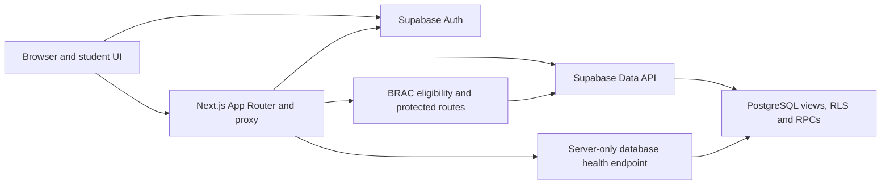
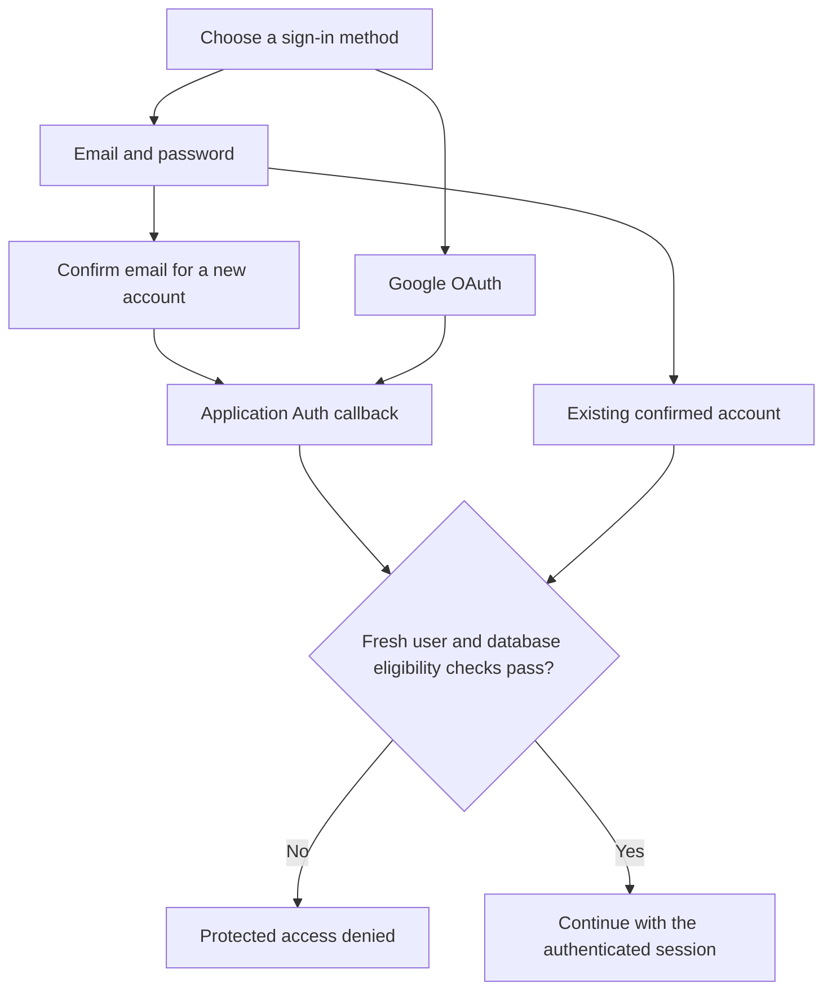
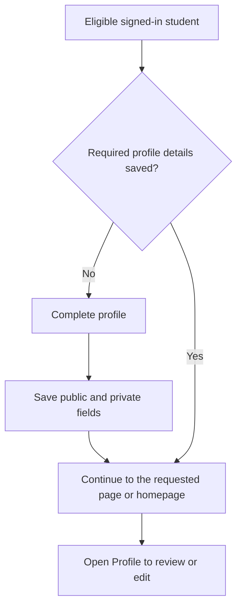
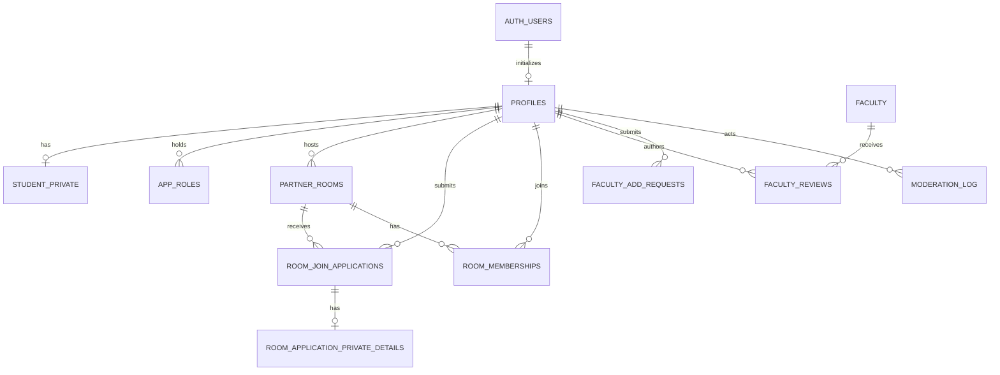

# Thesis Connect

**Find thesis partners, explore supervisors, and share faculty feedback at BRAC University.**

Thesis Connect gives BRAC University students a place to find collaborators and compare supervisor feedback before starting a thesis. Visitors can browse public room and faculty listings. Student features require a confirmed, eligible `@g.bracu.ac.bd` email address.


## Contents

- [Features](#features)
- [Technology and architecture](#technology-and-architecture)
- [Authentication and onboarding](#authentication-and-onboarding)
- [Database design](#database-design)
- [Security and privacy](#security-and-privacy)
- [Local development](#local-development)
- [Testing and project status](#testing-and-project-status)
- [Contributing and roadmap](#contributing-and-roadmap)

## Features

| Area | What the repository implements |
| --- | --- |
| 🔐 Accounts | Email/password registration and sign-in, Google OAuth, confirmation and resend, password recovery and reset, and Supabase session handling. Google and email delivery depend on the development project's configuration. |
| 🎓 Student profile | A shared onboarding and edit form for full name, student ID, department, CGPA, current semester, and an optional response about BRAC University. Saved information is loaded from the database on later visits. |
| 🤝 Partner rooms | Browse public room summaries, create and preview a room, apply to join, withdraw an application, and accept or reject applications as the room host. Contact links are stored separately from discovery data. |
| 📝 Faculty reviews | Browse the faculty directory, submit faculty suggestions, and create, edit, or delete your own reviews. Eligible readers see published feedback with the author label **Anonymous Student**. Staff workflows handle faculty requests and review moderation. |
| 🏠 Navigation | The homepage shows **Sign In** for signed-out visitors and **Profile** for signed-in users. The profile page supports editing and logout, with a return to the homepage after successful sign-out. |
| 💬 Forum | A **Coming Soon** page introduces the discussion area. Posting and replies are planned. |

## Technology and architecture

| Layer | Technology |
| --- | --- |
| Web application | Next.js 16.4.4 App Router, React 19.2.6, TypeScript 5.9.3 |
| UI and branding | Tailwind CSS 4.1.17, shared button and layout components, locally served BRAC University monogram |
| Identity | Supabase Auth, `@supabase/ssr` 0.12.7, `@supabase/supabase-js` 2.118.0 |
| Application data | Supabase Data API backed by PostgreSQL, RLS, views, and restricted database functions |
| Database health | Drizzle ORM 0.45.2 and `pg` 8.20.0 for the server-side database health endpoint |
| Checks | Node.js test runner, TypeScript, ESLint 9.39.4 |



Next.js handles route protection and session-cookie updates. Browser data adapters use the signed-in Supabase session. PostgreSQL enforces row access and privileged operations when requests reach the Data API, including requests made outside the UI.

## Authentication and onboarding



Registration and verification resend use an application callback URL. Password recovery also returns through the callback before opening the reset page. The callback handles supported Auth codes or token-hash links, checks eligibility, and uses a safe internal destination.



The baseline Auth signup trigger initializes the profile row. Onboarding completion depends on persisted fields. CGPA accepts **0.00–4.00** with up to two decimal places. Current semester is free text, and a blank BRAC University response is saved as `NULL` and does not prevent completion. The profile form does not collect a phone number, address, picture, or manually entered account email.

## Database design

| Objects | Purpose |
| --- | --- |
| `profiles`, `student_private`, `app_roles` | Basic profile fields, separately stored private student details, and application roles |
| `partner_rooms`, `room_join_applications`, `room_application_private_details`, `room_memberships` | Room listings, applications and decisions, private contact details, and membership |
| `faculty`, `faculty_reviews`, `faculty_add_requests`, `moderation_log` | Faculty directory, review records, suggested additions, and moderation records |
| `partner_rooms_public`, `faculty_public` | Limited discovery projections for visitors and students |
| `faculty_reviews_public` | Published review projection for eligible authenticated readers. It masks author identity and omits the reviewer ID. |



Full name (stored as display name) and department live in `profiles`. Student ID, CGPA, current semester, and the optional BRAC University response live in `student_private`. Sharing a database schema does not make those records public. Grants, ownership policies, and view projections define what each role can read or write.

### Migration order

Apply the reviewed files in [supabase/migrations](supabase/migrations/) in the following order.

| Step | Migration | Purpose |
| --- | --- | --- |
| 1 | `20261028190000_phase_2b_schema.sql` | Tables, constraints, indexes, and triggers |
| 2 | `20261028190100_phase_2b_rls_and_views.sql` | RLS, grants, and discovery views |
| 3 | `20261028190200_phase_2b_secure_rpcs.sql` | Restricted room, review, and moderation functions |
| 4 | `20261031120000_phase_4_2a_create_own_faculty_review.sql` | Author-scoped review creation |
| 5 | `20261031121000_phase_4_2b_faculty_review_rpc_only.sql` | Review write permissions restricted to RPCs |
| 6 | `20261031122000_phase_4_3_submit_faculty_add_request.sql` | Faculty suggestion submission RPC |
| 7 | `20261031123000_phase_4_4_harden_phase_2b_rpc_search_paths.sql` | Hardened function search paths |
| 8 | `20261101130000_phase_4_5_delete_own_faculty_review.sql` | Author-scoped review deletion |
| 9 | `20261105120000_brac_email_eligibility.sql` | Current-user eligibility helper, signup hook function, restrictive RLS, and gates for privileged functions and the review view |
| 10 | `20261106120000_student_private_profile_details.sql` | Nullable CGPA, semester, and BRAC University response columns with range and length checks |

The filename prefix is the migration version. The application migration ledger is `supabase_migrations.schema_migrations`, with version, name, and statements. The SQL files define schema changes. For manual execution, use a reviewed process that records the matching history entry in the same transaction. Supabase Auth's internal migration history is separate.

## Security and privacy

- **Application boundary.** Server-side guards retrieve the current user through Supabase Auth and require an affirmative database eligibility result. Missing identity, unconfirmed email, and eligibility errors deny protected access. Frontend validation helps users correct input before submitting it.
- **Auth boundary.** The database eligibility helper checks the current primary email on the managed Auth record, including confirmation state. It excludes anonymous and deleted identities, requires the exact BRAC domain case-insensitively, and rejects plus-addressing. User-editable metadata and stale JWT email claims cannot substitute for this check. Google and email/password sessions face the same protected-access rules.
- **Account creation.** The BRAC migration defines a Before User Created hook for eligible email addresses. The development project must explicitly enable the hook in Supabase Auth for signup admission enforcement. Domain-valid password signups can proceed to email confirmation before gaining student access.
- **Database boundary.** Restrictive eligibility policies intersect with existing ownership and staff rules across the eleven application tables. Privileged RPCs check eligibility and their own business permissions. Administrator and moderator roles do not bypass BRAC eligibility. The profile form and data layer validate input, and PostgreSQL constrains the values it stores.
- **Private data.** Student IDs and private profile details are absent from discovery views. Room application contact links live separately and are subject to access rules. Review readers see an anonymized projection. The review author can manage their own entry through ownership-checked functions.
- **Credentials.** Keep private configuration in ignored local files or approved secret stores. The browser receives only the development project URL and publishable key. Direct database access is server-only.

## Local development

**Prerequisites:** Git, Node.js 20.9 or newer, npm, and an authorized development Supabase project with the reviewed schema. The Node minimum comes from the pinned Next.js package.

```bash
git clone https://github.com/ayonitis/thesis-connect.git
cd thesis-connect
npm ci
```

Create `.env.local` in the repository root. The following lists the variable names with deliberately empty values.

```dotenv
NEXT_PUBLIC_SUPABASE_URL=
NEXT_PUBLIC_SUPABASE_PUBLISHABLE_KEY=
DATABASE_URL=
```

| Variable | How it is used |
| --- | --- |
| `NEXT_PUBLIC_SUPABASE_URL` | Public. Use the development project's API URL from its Supabase settings. |
| `NEXT_PUBLIC_SUPABASE_PUBLISHABLE_KEY` | Public. Use the publishable key for that same project. |
| `DATABASE_URL` | Server-only. Supply an authorized development database connection only if exercising the direct database health endpoint or Drizzle tooling. |

> [!IMPORTANT]
> Use development credentials for local work. Keep production credentials, service-role keys, OAuth secrets, and SMTP credentials out of local app configuration and Git.

1. Verify the target project and migration history. If the development schema needs setup, use the reviewed migration order above with an authorized operator.
2. In development Auth settings, enable email/password and email confirmation for the intended signup flow. Configure email delivery for confirmation and recovery, and allow the local application callback at `http://localhost:3000/auth/callback` with the query destinations used by the app.
3. Enable the Before User Created hook and select `thesis_brac_auth.before_user_created` for managed signup enforcement.
4. For Google sign-in, configure the Google provider in development Supabase Auth. Use the provider callback displayed by Supabase as the authorized redirect URI in Google, and keep the local application callback on the Supabase redirect allowlist. Store Google credentials in the provider settings.
5. Start Next.js and open [http://localhost:3000](http://localhost:3000).

```bash
npm run dev
```

## Testing and project status

```bash
npm test
npm run typecheck
npm run lint
```

The public suite checks eligibility rules, authorization guard behavior, safe Auth feedback, review ownership calls, profile completion and persistence with synthetic clients, migration integrity, and dependency compatibility. It runs offline using repository files and installed dependencies. For test scope, see [tests/README.md](tests/README.md).

| Latest reported check | Result |
| --- | --- |
| Public tests | **278 passed**, **0 failed**, **10 TODO** |
| TypeScript | Passed |
| ESLint | Passed |

These results cover offline tests and static checks. Hosted Google and email signup, confirmation and session refresh, real JWT/RLS behavior, and browser session handling still require end-to-end verification. See the [pending integration test plan](tests/BRAC_PENDING_INTEGRATION_TEST_PLAN.md). This README does not assert a live deployment status.

## Contributing and roadmap

- Keep changes focused and run the public tests, typecheck, and lint before opening a pull request.
- Include regression coverage for authorization and ownership changes. Use synthetic records for local tests and keep private evidence and configuration out of Git.
- Treat applied migrations as immutable. Propose a new timestamped migration for schema changes, review its order and privileges, and confirm the target and ledger before execution. Avoid rerunning applied SQL or repairing history without evidence and explicit approval.

**Planned:** Complete the hosted Auth, JWT/RLS, and browser acceptance cases in development. Forum discussion is still a placeholder.
